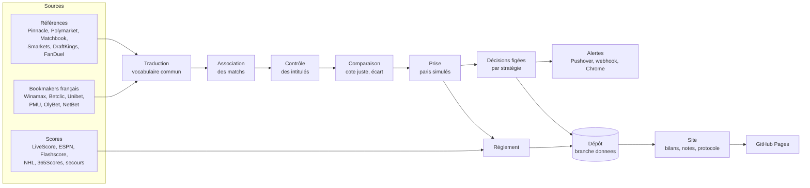

# Architecture cible et plan de refonte

Rédigé le 15/11/2026. Proposition : aucun code n'est modifié par ce document.

But : un projet où l'on ajoute une source, une stratégie ou une tâche en touchant **un seul endroit**, où chaque étape
du cycle se teste seule, et où le stockage est décrit par un catalogue. Sans coût en plus (GitHub Actions, Pages,
branche `donnees`, Supabase et serveur facultatif restent) et sans changer ni les formats de `donnees`, ni les règles
figées des stratégies.

## 1. Existant

Mesures du 15/11/2026 : 77 modules dans `cotes/` (16 594 lignes), 12 lecteurs dans `cotes/direct/` (6 093), 26 scripts
(9 171), 9 workflows (834 lignes de YAML), 4 968 lignes de site (`web/`). 1 691 tests Python verts en 80 s, 10
fichiers de tests JavaScript.

### 1.1 Modules (rangement logique actuel, tout est à plat dans `cotes/`)

| Groupe | Modules |
|---|---|
| Sources de cotes | `pinnacle`, `pinnacle_secours`, `polymarket`, `polymarket_flux`, `smarkets`, `direct/*` (Winamax, Betclic, Unibet, PMU, OlyBet, NetBet, Matchbook, Betfair, FanDuel, DraftKings, horizon) |
| Sources de scores | `resultats` (ESPN), `livescore`, `flashscore`, `scores365`, `resultats_nhl`, `theodds`, `propline`, `thesportsdb` |
| Traduction | `pulsescore` (`traduire`), `marches`, `joueurs`, `inconnus` |
| Domaine | `correspondance`, `comparaison`, `controle`, `marge`, `mouvement`, `fraicheur`, `props`, `props_papier` |
| Paris | `simulation`, `reglement`, `sources_resultats`, `liens`, `mises`, `stockage` |
| Stratégies | 19 `strategie_*`, `strategies_prudentes` (58 variantes), `convergence` (7), `laboratoire` (24 règles), `decisions`, `memo`, `pauses`, `strategie_recommandee` |
| Bilans | `analyste`, `notation`, `recommandations`, `protocole`, `decision`, `evenements`, `analyse_marche/` |
| Alertes | `notifications`, `ordres`, `recap_jouables` ; envoi dans `scripts/envoyer_notifications.py` (587 lignes) |
| Exploitation | `echecs`, `derive`, `surveillance`, `protection`, `securite`, `delai`, `connexion`, `temps` |
| État de travail | `historiques`, `memoire`, `reprise` |
| Orchestration | `scripts/cycle.py` (1 198 lignes), `scripts/site_web.py` (974), `scripts/serveur_direct.py` |
| Études | 15 scripts dans `scripts/` (`cote_juste`, `modele_prix`, `recherche_cloture`, `strategie_mises`…) |

### 1.2 Flux d'un cycle

`scripts/cycle.py › main()` (230 lignes, deux modes) enchaîne tout : collecte en parallèle (`collecter_prematch`,
290 lignes), bourses, Smarkets, dérive, association, contrôle des intitulés, comparaison, props, mouvement, placement,
décisions figées, Qwen, CLV, règlement, sauvegarde, état, surveillance, puis le site. Les données passent par des
variables locales et un dictionnaire `journal` qui sert aussi de sortie.

### 1.3 Stockage

| Où | Quoi | Taille |
|---|---|---|
| Branche `donnees`, réécrit à chaque cycle | `paris.json`, `etat.json`, `controle.json`, `opportunites_actuelles.json`, ~25 fichiers d'état (recommandées, pauses, notes, dédoublonnage des alertes, caches de scores…) | `paris.json` 12,2 Mo |
| Branche `donnees`, ajout seul, un fichier par jour | `cotes/`, `opportunites/`, `references/`, `releves/`, `correspondances/` | 178 Mo |
| Branche `donnees`, archives | `archives/` (paris réglés depuis plus de 30 jours) | 0,2 Mo |
| Releases GitHub | mois passés de `cotes/` et `opportunites/` (`archivage-donnees.yml`) | — |
| Cache Actions | `memoire/` (sauvé après un push réussi), `reprise/` et `envoyes/` (toujours sauvés) | quelques Mo |
| Supabase | abonnements Chrome et choix Pushover (`cv-notifications`), réchauffeur Pinnacle | — |
| GitHub Pages | site produit (`index.html`, `notifications.json`, `ordres.json`, `mises/*.json`…) | — |

Un commit et un push par cycle (toutes les 5 min sur GitHub, 5 min aussi sur le serveur).

### 1.4 Tâches planifiées

| Tâche | Où | Quand | Fait |
|---|---|---|---|
| Collecte et comparaison | `collecte.yml` | chaîne qui se relance 5 min après son début ; cron `7 * * * *` pour la redémarrer | cycle, alertes, règlement si ≥ 55 min, push, site, relance |
| Règlement | `reglement.yml` | `27 * * * *`, sauf serveur actif | règlement, site |
| Surveillance | `surveillance-collecte.yml` | `17,47 * * * *` | relance la chaîne arrêtée |
| Site | `site.yml` | push sur le code du site, à la main, ou appel du serveur | reconstruit sans collecter |
| Archivage | `archivage-donnees.yml` | `17 3 5 * *` | release mensuelle des données brutes |
| Tests | `tests.yml` | push et PR | secrets, pytest, node, deno |
| Sondes, test Pushover | 3 workflows | à la main | diagnostic |
| Serveur en direct | systemd, `serveur_direct.py` | cycle 60 s, push 5 min, code 1 h | remplace la chaîne GitHub |
| Dans le code | récap Pushover 11 h, révision des recommandées tous les 7 jours, publication de `controle.json` toutes les heures | — | — |

Verrous : groupe de concurrence `donnees` sur GitHub ; battement `serveur_direct.json` entre GitHub et le serveur.

### 1.5 Points faibles

1. **Script-dieu** : `cycle.py` mêle orchestration, règles et écriture ; `main()` a deux chemins qui écrivent les
   mêmes fichiers dans un ordre recopié. Aucune étape ne se teste seule ; le cycle complet n'a aucun test hors réseau
   (limite déjà notée dans `docs/simplification.md`).
2. **Ajouter une source touche 4 à 6 endroits de `cycle.py`** : `BUDGETS`, `MEMOIRES`, appel `lancer(...)`,
   exclusions du contrôle, `hors_consensus`, compteurs du journal. Interfaces inégales : `mode()` ou `mode_source()`,
   liste ou `(lignes, meta)`.
3. **Ajouter une stratégie touche plusieurs registres** : `convergence.STRATEGIES`, `strategies_prudentes.VARIANTES`,
   `laboratoire.REGLES`, la liste écrite à la main de `decisions.figer_nouveaux` (Grok 1 à 5), et 7 imports de
   stratégies un par un dans `site_web.py`.
4. **Configuration éparpillée** : au moins 35 variables d'environnement lues par `os.environ` dans 21 fichiers ; les
   valeurs par défaut sont recopiées dans le YAML (`vars.X || '10'`) et dans le code, sans contrôle qu'elles
   concordent.
5. **Stockage sans catalogue** : ~25 fichiers à la racine de `donnees`, écrits par des modules différents, 15 fichiers
   avec leur propre écriture atomique ; personne ne liste qui écrit quoi ni combien de temps on garde.
6. **Dépendances à l'envers** : `scripts/envoyer_notifications.py` importe `scripts/cycle.py` ; `cycle.py` importe
   `site_web` par `sys.path` ; listes d'erreurs globales et mutables dans 8 modules (`ERREURS`).
7. **Tâches en shell dans le YAML** : la relance de la chaîne (85 lignes de bash dans `collecte.yml`) est critique ;
   ses tests rejouent le bash extrait du YAML.
8. **Site monolithique** : `site_web._construire` fait 340 lignes (lecture, calcul, rendu, écriture d'états).
9. **Études et exploitation mélangées** dans `scripts/`.

Ce qui marche et reste : lecteurs directs robustes et testés, budgets par source, reprise des références, décisions
figées à la prise, protocole scellé (`tests/test_protocole.py` rejoue chaque stratégie sur un jeu témoin), un seul
push par cycle, relais GitHub ↔ serveur.

## 2. Architecture cible

### 2.1 Principes

- **Couches à sens unique** : socle ← sources ← domaine ← paris ← stratégies ← bilans ← alertes/site ← étapes du cycle
  ← points d'entrée. Une couche n'importe que celles à sa gauche. `cotes/` n'importe jamais `scripts/`.
- **Un registre par chose qui s'ajoute** : sources, stratégies, fichiers, variables, tâches.
- **Étapes du cycle pures sur un contexte** : chaque étape lit et remplit un `Contexte`, sans variable globale.
- **Un seul point d'entrée** : `python -m cotes <commande>`, appelé à l'identique par GitHub et par le serveur.
- **Rien ne change dehors** : mêmes fichiers et formats dans `donnees`, même site, mêmes clés du journal.
- **Fichiers figés intouchables** : `strategie_jules_v2.py`, `strategie_commune.py`, `strategie_jules.py`,
  `correspondance.py`, `decisions.py` (empreintes de `scripts/verifier_strategie_jules_v2.py`) ne sont ni modifiés
  ni déplacés. Les règles des stratégies ne changent pas (`tests/test_protocole.py`).

### 2.2 Modules

```
cotes/
  __main__.py          point d'entrée : cycle | reglement | alertes | site | relancer | archiver
  config.py            catalogue des variables d'environnement (nom, défaut, type, rôle)
  depot/               stockage
    catalogue.py       chaque fichier de donnees : format, écrivain, lecteurs, rétention, emplacement
    json_io.py         lire / écrire JSON et gzip de façon atomique (formats actuels conservés)
    (stockage, historiques, memoire, reprise)
  sources/
    registre.py        Source(nom, rôle, budget, mode, mémoire, consensus, contrôle, dépend du radar)
    (pinnacle, polymarket, smarkets, direct/*, scores…)
  domaine/             traduction, association, contrôle, comparaison, marge, mouvement, props
  paris/               placement, CLV, règlement, résultats, mises, liens
  strategies/
    registre.py        Strategie(clé, nom, famille, version, début, sélecteur, figée)
    (strategie_*, variantes, laboratoire, convergence)
  bilans/              analyste, notation, recommandations, protocole, décision, analyse_marche
  alertes/             flux, Pushover, webhook, Chrome, ordres, récap
  exploitation/        échecs, dérive, surveillance, protection, sécurité, délais, temps
  pipeline/
    contexte.py        Contexte du cycle (heure, mode, dossiers, lignes, index, opportunités, paris, journal)
    collecte.py  analyse.py  prise.py  reglement.py  sauvegarde.py
  site/                charger → calculer → rendre → écrire
scripts/               enveloppes fines (cycle.py, site_web.py, envoyer_notifications.py, serveur_direct.py, relancer.py)
etudes/                scripts d'étude, hors exploitation
web/                   gabarit et JavaScript du site (inchangé)
```

Les dossiers entre parenthèses sont un rangement final facultatif (phase 7) : les couches valent d'abord par le test
d'architecture (E0.3), sans déplacer de fichier.

### 2.3 Flux de données



Un cycle = `collecte → analyse → prise → (alertes) → règlement si échu → sauvegarde → site`. Chaque flèche est une
fonction de `cotes/pipeline/` qui reçoit et rend le `Contexte`.

### 2.4 Stockage

| Zone | Contenu | Règle |
|---|---|---|
| Chaud (branche `donnees`) | `paris.json` (paris ouverts et récents), `etat.json`, états des stratégies, dédoublonnage des alertes | réécrit par le seul moteur, écriture atomique, déclaré dans `depot/catalogue.py` |
| Froid (branche `donnees`) | un fichier par jour en ajout seul ; archives mensuelles des paris | jamais réécrit ; mois passés vers les releases |
| Cache Actions | `memoire/` (aligné sur le dernier push réussi), `reprise/`, `envoyes/` (toujours sauvés) | perte possible : démarrage à froid prévu |
| Externe | Supabase (abonnements, choix Pushover), Pages (produit) | jamais lu par le cycle, sauf les choix Pushover |

Le catalogue dit pour chaque fichier : format exact (indentation, ASCII, niveau gzip), écrivain, lecteurs, rétention,
zone. Un test refuse un fichier écrit sans y être déclaré. Pas de base de données : la branche reste la vérité,
auditable et gratuite.

### 2.5 Tâches planifiées

Même calendrier qu'aujourd'hui (tableau 1.4), mais :

- chaque tâche appelle `python -m cotes <commande>` (GitHub, serveur et poste local font la même chose) ;
- la relance de la chaîne est un script Python testé (`scripts/relancer.py`), utilisé par `collecte.yml` et
  `surveillance-collecte.yml` ;
- le calendrier est déclaré une fois (tableau ci-dessus) et un test vérifie que les `cron:` des workflows y
  correspondent.

### 2.6 Contrats

```python
@dataclass(frozen=True)
class Source:                      # cotes/sources/registre.py
    nom: str                       # clé du journal, ex. "pmu_direct"
    role: str                      # "reference" | "francais" | "bourse" | "reference_props" | "scores"
    budget_s: float                # aujourd'hui dans cycle.BUDGETS
    lire: Callable[..., tuple[list[dict], dict]]   # (lignes, meta), même forme pour toutes
    mode: Callable[[], str]        # "direct" | "shadow" | "off"
    memoire: str | None = None     # aujourd'hui dans cycle.MEMOIRES
    dans_consensus: bool = True
    dans_controle: bool = True     # False pour Smarkets, Matchbook, Betfair
    attend_radar: bool = False     # True pour Unibet (part après Pinnacle)

@dataclass(frozen=True)
class Strategie:                   # cotes/strategies/registre.py
    cle: str
    nom: str
    famille: str                   # "base", "variante", "labo", "grok", "fusion"…
    version: str
    debut: str | None
    selectionner: Callable[[list[dict]], set[int]]
    figee: bool                    # fichier sous empreinte : ne pas modifier
```

## 3. Existant et cible

| Sujet | Existant | Cible |
|---|---|---|
| Orchestration | `cycle.main()` de 230 lignes, deux chemins | 5 étapes de `pipeline/`, `main()` < 60 lignes |
| Test du cycle | règlement seul, collecte jamais testée hors réseau | cycle à blanc complet, sans réseau, en < 5 s |
| Ajouter une source | 4 à 6 endroits de `cycle.py` | un module + une entrée du registre |
| Ajouter une stratégie | 3 registres + imports du site | un fichier + une entrée du registre + inscription au protocole |
| Configuration | 35 variables et plus dans 21 fichiers, défauts recopiés | `config.py`, défauts du YAML vérifiés par test |
| Stockage | ~25 fichiers sans liste, 15 écritures atomiques | catalogue testé, une E/S JSON pour le cycle, le site et les alertes |
| Dépendances | scripts qui s'importent entre eux | couches à sens unique vérifiées par test |
| Tâches | bash de 85 lignes dans le YAML | `python -m cotes …`, relance en Python testée |
| Site | `_construire` de 340 lignes | charger → calculer → rendre → écrire |
| Non-régression | empreinte du site faite à la main en novembre | `scripts/empreinte_site.py` reproductible |
| Formats `donnees`, règles figées, site | — | inchangés |

## 4. Plan de refonte

### 4.1 Règles communes (à lire avant chaque étape)

1. Une étape = un commit, une PR. Ne faire **que** l'étape demandée. Ne jamais mélanger rangement et changement
   de comportement.
2. Ne jamais modifier ni déplacer les 5 fichiers figés (2.1), ni `cotes/protocole_registre.json`, ni le gabarit
   `web/modele.html`, sauf si l'étape le dit.
3. Avant de déplacer une fonction : `grep -rn "cycle\.<nom>\|<module>\.<nom>" tests/`. Un `monkeypatch.setattr` sur
   l'ancien emplacement doit viser le nouveau ; ne changer aucune assertion.
4. Garder l'ancien nom disponible là où d'autres l'importent (`from nouveau import nom` dans l'ancien module).
5. **Contrôle standard**, à lancer avant et après :
   ```bash
   python scripts/verifier_secrets.py
   python -m pytest -q tests 2>&1 | tail -3
   node --test tests/*.test.mjs 2>&1 | tail -5
   ```
   Empreinte du site (même résultat attendu avant et après, sauf mention contraire) :
   ```bash
   bash scripts/cloner_donnees.sh "$(git remote get-url origin)" ../donnees-ref    # une fois, hors du dépôt
   python scripts/empreinte_site.py --donnees ../donnees-ref --sortie ../avant.json  # avant le changement
   python scripts/empreinte_site.py --donnees ../donnees-ref --comparer ../avant.json  # après : « identique »
   ```
6. Si un test échoue et que la cause n'est pas évidente en deux essais : annuler l'étape (`git checkout .`) et le
   noter dans la PR plutôt que modifier un test.
7. À la fin : cocher l'étape dans le tableau 4.10 de ce fichier.

Pour confier une étape à un autre modèle : « Lis `docs/architecture-cible.md`, sections 4.1 et E<n>. Fais seulement
cette étape. »

### 4.2 Phase 0 — Filets de sécurité (aucun comportement changé)

**E0.1 — Empreinte du site reproductible**
- Fichiers : nouveau `scripts/empreinte_site.py`, nouveau `tests/test_empreinte_site.py`.
- Faire : `--donnees DOSSIER --maintenant 2026-11-15T12:00:00+00:00 --sortie empreinte.json`, et
  `--comparer ref.json`. Le script se relance lui-même avec `PYTHONHASHSEED=0` s'il ne l'a pas ; copie `--donnees`
  dans un dossier temporaire ; fige l'heure (dans chaque module chargé de `cotes`, `scripts` et `site_web` dont
  l'attribut `datetime` est `datetime.datetime`, le remplacer par une sous-classe dont `now()` rend l'heure donnée) ;
  appelle `site_web.construire(copie, sortie)` ; écrit le sha256 de chaque fichier du site et de chaque fichier de la
  copie qui a changé. `--comparer` liste les différences et sort en code 1.
- Test : petit dossier `donnees` fabriqué dans le test (3 paris) ; deux passages donnent la même empreinte ; un pari
  modifié la change.
- Données de référence : `git clone --branch donnees`, puis `git checkout <sha>` ; noter le sha dans la PR.
- Fini quand : deux passages de suite sur les vraies données donnent un `--comparer` vide.
- Fait le 15/11/2026. Les chronomètres (`perf_counter`, `monotonic`) sont aussi figés à 0 : `protection.py` publie la
  durée de chaque stratégie dans la page, qui changeait sinon à chaque construction. Sur le clone partiel de
  `donnees` au commit `1829127` : 17 fichiers, deux passages identiques, 24 s chacun.

**E0.2 — Cycle à blanc hors réseau**
- Fichier : nouveau `tests/test_cycle_a_blanc.py`.
- Faire : appeler `cycle.main()` avec `--mode complet --donnees <tmp> --sans-site --reglement non` (via
  `monkeypatch.setattr(sys, "argv", …)`). Couper par variables : `SOURCE_MATCHBOOK=off`, `SOURCE_FANDUEL=off`,
  `SOURCE_DRAFTKINGS=off`, `SOURCE_OLYBET=off`, `SOURCE_NETBET=off`, `SMARKETS_COLLECTE=non`, `REPRISE_CHEMIN` vide.
  Remplacer `pinnacle.collecter` (un match de football, 1N2), `polymarket.collecter` (vide) et `collecter` des
  lecteurs français restants (Winamax : la même affiche avec une cote 5 % au-dessus de la cote juste ; les autres :
  `([], {"ok": True, "erreurs": [], "requetes": 0})`). Reprendre la forme des lignes dans
  `tests/test_collecte_parallele.py`. Bloquer `socket.socket.connect` pour prouver l'absence de réseau.
- Vérifier : code 0 ; un pari Winamax dans `paris.json` ; une ligne dans `opportunites/<jour>.jsonl.gz` ;
  `etat.json › dernier_cycle` a `cotes`, `opportunites`, `nouveaux_paris`, `etapes` ; un second passage n'ajoute
  aucun pari.
- Fini quand : test vert en moins de 5 s.
- Fait le 15/11/2026 : deux tests, 0,1 s. Le contrôle des intitulés est pré-rempli « conforme » (sinon le premier
  cycle ne prend aucun pari) ; `SOURCE_BETFAIR=off` et `pinnacle_secours.disponible` coupés en plus.

**E0.3 — Test d'architecture**
- Fichier : nouveau `tests/test_architecture.py`.
- Faire : `COUCHES = {"cotes.pinnacle": "sources", …}` pour chaque module de `cotes/` et `scripts/` (couches de 2.1,
  plus `scripts` et `etudes`) ; lire les imports avec `ast` (y compris dans les fonctions) ; refuser tout import vers
  une couche plus à droite. Les violations actuelles vont dans `EXCEPTIONS = {(importeur, importé), …}`.
- Le test échoue si : un module n'est pas classé ; une nouvelle violation apparaît ; une exception de la liste
  n'existe plus (la retirer).
- Fini quand : test vert ; le nombre d'exceptions est noté dans la PR. Chaque étape suivante doit le faire baisser
  ou le laisser égal.
- Fait le 15/11/2026 : **23 exceptions**. Couche « vocabulaire » ajoutée entre socle et sources (`pulsescore`,
  `marches`, `joueurs`, `inconnus`, `marge`, `correspondance`, `liens`) : les lecteurs traduisent en lisant. Les
  modules d'exploitation sans dépendance (`echecs`, `protection`, `surveillance`, `derive`…) sont au socle. Un script
  d'exploitation qui importe un autre script compte comme violation (les études en sont exemptes).

### 4.3 Phase 1 — Socle

**E1.1 — Catalogue de configuration**
- Fichiers : nouveau `cotes/config.py`, nouveau `tests/test_config.py`.
- Faire : `VARIABLES = {"PINNACLE_AGE_MAX_MIN": Variable(defaut="10", type=float, role="…"), …}` pour chaque
  variable lue par le code ou passée par un workflow (secrets : nom seulement ; chercher aussi les fonctions d'aide
  qui lisent l'environnement) ; `lire(nom, environ=os.environ)` rend la valeur typée ou le défaut. Aucun
  module ne change encore.
- Test : (a) chaque nom lu par `os.environ` dans `cotes/` et `scripts/` est déclaré ; (b) chaque
  `${{ vars.NOM || 'x' }}` des workflows a `x` égal au défaut du catalogue ; (c) les noms de `.env.example` et
  `serveur/env.exemple` sont déclarés.
- Fini quand : tests verts. Un défaut qui ne concorde pas n'est **pas** corrigé ici : le lister dans la PR.
- Fait le 15/11/2026 : 62 variables (`python -m cotes.config` imprime le tableau). Défaut effectif du code (ex.
  `PINBOOK_SPORTS` vide = `football,tennis,basket`). Trois écarts YAML ≠ code, gardés dans
  `tests/test_config.py › ECARTS_CONNUS` : `SMARKETS_COLLECTE` (`oui` / `non`), `SOURCE_FANDUEL` et
  `SOURCE_DRAFTKINGS` (`direct` / `off`).

**E1.2 — Les modules lisent `config.lire`** (facultatif, un module par commit)
- Remplacer `os.environ.get("X", "d")` par `config.lire("X")` sans changer le défaut. Test : tests du module.

**E1.3 — Catalogue des fichiers de `donnees`**
- Fichiers : nouveau `cotes/depot/__init__.py`, `cotes/depot/catalogue.py`, `tests/test_catalogue.py`.
- Faire : `FICHIERS = {"paris.json": Fichier(zone="chaud", format="json indent=1", ecrivains=["scripts/cycle.py"],
  lecteurs=[…], retention="paris réglés < 30 j"), "cotes/*.jsonl.gz": …, …}` pour chaque fichier de la branche, de
  `memoire/`, `reprise/` et `envoyes/`. `python -m cotes.depot.catalogue --markdown` imprime le tableau.
- Test : chaque littéral `"….json"`, `"….json.gz"` ou `"….jsonl.gz"` utilisé avec `donnees /`, `memoire.lire` ou
  `memoire.ecrire` est au catalogue ; aucun `FICHIERS_OBSOLETES` n'y est ; aucune entrée du catalogue n'est morte.
- Fini quand : tests verts ; tableau copié dans `docs/donnees.md`.
- Fait le 15/11/2026 : 45 entrées (27 chaudes, 6 froides, 7 mémoire, 3 reprise, 2 envoyes). Les chemins dont le nom
  est une variable (`f"{nom}.json"`, `dossier / f"{jour}…"`) ne sont pas vérifiés par le test.

**E1.4 — Une E/S JSON pour le cycle, le site et les alertes**
- Fichiers : nouveau `cotes/depot/json_io.py` ; `scripts/cycle.py`, `scripts/envoyer_notifications.py`.
- Faire : copier telles quelles `lire_json` et `ecrire_json` de `cycle.py` dans `json_io.py` ; `cycle.py` les
  importe (les noms restent sur le module) ; remplacer les deux `from scripts.cycle import ecrire_json` de
  `envoyer_notifications.py`. Ne pas toucher aux autres écritures.
- Test : contrôle standard, empreinte identique, une exception de moins dans E0.3.
- Fait le 15/11/2026 : cinq imports remplacés (quatre dans `envoyer_notifications.py`, un dans `envoyes_secours.py`) ;
  21 exceptions (deux de moins). Empreinte identique (17 fichiers, `donnees` au commit `715ed0c`).

### 4.4 Phase 2 — Sources

**E2.1 — Registre des sources (données seulement)**
- Fichiers : nouveau `cotes/sources/__init__.py`, `cotes/sources/registre.py`, `tests/test_registre_sources.py`.
- Faire : la classe `Source` de 2.6 et une entrée par source, remplie depuis `cycle.BUDGETS`, `cycle.MEMOIRES`, les
  exclusions de `index_controle` (`Smarkets`, `Matchbook`, `Betfair`), `smarkets.hors_consensus()`,
  `matchbook.hors_consensus()` et le cas Unibet. `lire` pointe vers le `collecter` actuel.
- Test : budgets du registre == `cycle.BUDGETS` ; mémoires == `cycle.MEMOIRES` ; exclusions identiques.
- Fait le 15/11/2026 : 13 sources de cotes (les lecteurs de scores viendront avec E2.5). Champ `reference` en plus
  (nom de la table dans `references`) et `hors_consensus` appelable (Smarkets dépend de `SMARKETS_DANS_DECISION`).

**E2.2 — Le cycle lit le registre**
- Faire : `BUDGETS`, `MEMOIRES` et la liste d'exclusion du contrôle de `cycle.py` deviennent des valeurs calculées
  depuis le registre (mêmes noms dans `cycle`). Test : contrôle standard, E0.2.
- Fait le 15/11/2026. `tests/test_betfair.py` lisait le littéral `"Matchbook", "Betfair")` dans le source de
  `main()` : il vérifie maintenant l'appel au registre et la présence de Betfair dans `hors_controle()`.
  `tests/test_registre_sources.py` garde les anciennes valeurs recopiées.

**E2.3 — Lecture de même forme pour toutes les sources**
- Faire : ajouter `mode()` à `direct/olybet.py` et `direct/netbet.py` (alias de `mode_source`, qui reste) ; dans le
  registre, adaptateurs qui rendent `(lignes, meta)` pour Pinnacle et Polymarket (aujourd'hui une liste).
- Test : un test par adaptateur avec `collecter` remplacé.
- Fait le 15/11/2026 : `meta` des adaptateurs = `ok` (aucune erreur), `erreurs` (copie de `ERREURS`), `lignes`.

**E2.4 — Lancement des bookmakers français en boucle**
- Fichier : `scripts/cycle.py › collecter_prematch`.
- Faire : remplacer les appels `lancer("pmu_direct", …)`, `lancer("winamax_direct", …)`… par une boucle sur
  `registre.francais()`, avec les arguments propres à chaque source déclarés dans le registre (`reserve`,
  `concurrence`, `maintenant`). Même ordre de lancement, mêmes arguments.
- Test : `tests/test_collecte_parallele.py`, `tests/test_budgets_cycle.py`, E0.2. Risque moyen.
- Fini quand : ajouter une source française = un module + une entrée de registre (le noter dans le README).
- Fait le 15/11/2026 : champs `module`, `avec_maintenant`, `concurrence`, `sports_test` ; `registre.ordre_de_lancement()`
  garde l'ordre PMU, Winamax, Betclic, OlyBet, NetBet. Unibet (radar) reste lancé à part ; la réception des lectures
  n'a pas changé. `tests/test_registre_sources.py` fige les arguments de chaque lancement (modes complet et test).

**E2.5 — Erreurs des lecteurs de scores sans liste globale** (facultatif, un module par commit)
- Faire : `lire()` rend aussi ses erreurs (nouvelle fonction ou tuple) ; la liste `ERREURS` reste remplie pour les
  appelants actuels, puis disparaît quand plus rien ne la lit.

### 4.5 Phase 3 — Cycle découpé

Toutes les étapes de cette phase sont des **déplacements** : même code, même ordre d'écriture, mêmes clés du journal.

**E3.1 — Contexte et chemin « règlement seul »**
- Fichiers : nouveaux `cotes/pipeline/__init__.py`, `contexte.py`, `reglement.py`.
- Faire : `Contexte` (heure, mode, `donnees`, reprise, journal, puis champs ajoutés aux étapes suivantes) ; déplacer
  `effectuer_reglement`, `_regler_props`, `reglement_echu`, `conserver_journal_reglement` et le corps du
  `if args.seulement_reglement:` dans `pipeline/reglement.py`. `cycle.py` garde ces noms par import ; les tests qui
  remplacent `cycle.effectuer_reglement` ou `cycle.REGLEMENT_MINUTES` visent le nouveau module.
- Test : `tests/test_cycle_reglement.py`, contrôle standard.
- Fait le 15/11/2026 : `regler_seul(ctx, mode)` ; le site et l'affichage restent dans `main()` (`cotes/` n'importe
  pas `scripts/`). Déplacés aussi, car le chemin règlement en a besoin : `etape`, `signaler`, `charger_paris`,
  `retirer_obsoletes` et `FICHIERS_OBSOLETES` (`cotes/pipeline/outils.py`). `tests/test_fichiers_obsoletes.py` exclut
  désormais le fichier qui écrit la liste au lieu de `cycle.py`.

**E3.2 — Étape sauvegarde**
- Faire : le bloc « 5. sauvegarde » de `main()` (archives, liens, `paris.json`, obsolètes, contrôle, opportunités,
  `etat.json`, surveillance) devient `pipeline/sauvegarde.py › sauvegarder(ctx)`. Le chemin règlement appelle la même
  fonction avec un drapeau pour sa partie commune, dans le même ordre.
- Test : E0.2, `tests/test_cycle_reglement.py`.
- Fait le 15/11/2026 : `sauvegarder(ctx, reglement_seul=False)` ; `lire_controle`, `enregistrer_controle` et
  `CONTROLE_PUBLICATION_MIN` déplacés avec (`cotes/pipeline/sauvegarde.py`), noms gardés sur `cycle`.

**E3.3 — Étape analyse**
- Faire : association → historique des références → contrôle → comparaison → props → mouvement → écarts d'affichage
  deviennent `pipeline/analyse.py › analyser(ctx)`.
- Test : E0.2, `tests/test_controle.py`, `tests/test_props_*.py`.
- Fait le 15/11/2026 : le `Contexte` est créé avant l'analyse (champs `references`, `hors_consensus`, `index`) et
  rempli jusqu'à la sauvegarde. `tests/test_betfair.py` lit l'ordre dans `main()` et l'association dans `analyser`.

**E3.4 — Étape prise**
- Faire : chargement des paris, retrait des supprimés, placement, fusions, pauses, décisions figées, redécision, Qwen,
  suivi des prix et clôture deviennent `pipeline/prise.py › prendre(ctx)`.
- Test : E0.2, `tests/test_decision*.py`, `tests/test_strategie_qwen.py`, `tests/test_protocole.py`.
- Fait le 15/11/2026 : `redecider` et `suivre_qwen` déplacés avec (`cotes/pipeline/prise.py`), noms gardés sur `cycle`.

**E3.5 — Étape collecte**
- Prérequis : E2.4.
- Faire : `collecter_prematch`, `appliquer_smarkets`, `appliquer_matchbook`, `appliquer_betfair`,
  `_appliquer_bourse`, `repli_reserve`, sports précédents et dérive vont dans `pipeline/collecte.py`. Mettre à jour
  les 12 `monkeypatch.setattr(cycle, "harmoniser_pinnacle", …)` des tests.
- Test : contrôle standard, E0.2. Plus gros déplacement de la phase.
- Fait le 15/11/2026 : `collecter(ctx)` reprend aussi la partie collecte de `main()` (bourses lancées au départ,
  marchés inconnus, Smarkets, dérive, `hors_consensus`). Les 13 remplacements de `harmoniser_pinnacle` visent
  `cotes.pipeline.collecte` ; `tests/test_betfair.py` et `tests/test_lancement_anticipe.py` lisent l'ordre dans
  `collecter`.

**E3.6 — `main()` ne fait plus qu'enchaîner**
- Faire : `main()` lit les arguments, crée le `Contexte` et appelle `collecter`, `analyser`, `prendre`, `regler`,
  `sauvegarder`, puis le site. Moins de 60 lignes.
- Test : contrôle standard, E0.1, E0.2, test de E0.3 (exceptions en baisse).
- Fait le 15/11/2026 : `main()` fait 49 lignes ; `scripts/cycle.py` passe de 1 198 à ~140 lignes (arguments,
  enchaînement, noms gardés pour les tests). Étape `regler(ctx, mode)` ajoutée. Empreinte identique ; 21 exceptions
  (l'import du site par `cycle.py` reste, il disparaîtra avec E5.4 et E6.1).

### 4.6 Phase 4 — Stratégies

Les règles ne changent pas : `tests/test_protocole.py` doit rester vert à chaque étape.

**E4.1 — Registre des stratégies en lecture seule**
- Fichiers : nouveaux `cotes/strategies/__init__.py`, `cotes/strategies/registre.py`, `tests/test_registre_strategies.py`.
- Faire : `toutes()` rend une `Strategie` (2.6) par clé, assemblée depuis `convergence.STRATEGIES`,
  `strategies_prudentes.VARIANTES`, `laboratoire.REGLES`, `strategie_grok.GROKS`, `CHATGPT`, `GEMINI`, `JULES`,
  `JULES_V2`, `EDEN`, `QWEN`, `M3` et les fusions. Aucun fichier existant modifié.
- Test : les clés du registre contiennent `protocole.definitions()` et celles que `site_web.navigation_strategies`
  affiche sur le jeu témoin (`tests/fixtures/protocole_temoin.json.gz`) ; pas de clé en double ; `figee=True` pour
  les stratégies des 5 fichiers figés.
- Fait le 15/11/2026 : 90 stratégies (7 bases, Convergence, 58 variantes en 6 familles, 24 règles du laboratoire).
  Champ `ligne` en plus (libellé du laboratoire et de la navigation). Le test rejoue la navigation du site sur le
  témoin et compare des sélections du registre à celles des sélecteurs d'origine.

**E4.2 — Le site lit le registre**
- Faire : dans `site_web.py`, là où le même traitement est répété pour chaque stratégie importée une à une,
  parcourir le registre. Test : empreinte identique.
- Fait le 15/11/2026 : les deux dictionnaires `officiels` (navigation et laboratoire) parcourent les bases du registre.
  Les sélecteurs du registre sont relus dans leur module à chaque appel. `test_navigation_strategies.py` remplace le
  registre du site par les sélecteurs du site (mêmes comptes d'appels attendus). Empreinte identique.

**E4.3 — Notifications, ordres et protocole lisent le registre** (un module par commit)
- Test : empreinte identique, `tests/test_notifications.py`, `tests/test_ordres.py`, `tests/test_protocole.py`.
- Fait le 15/11/2026 pour les notifications : `NOMS` vient du registre (champ `court` ajouté, numérotation du
  laboratoire déplacée), même ordre et mêmes noms (test). `ordres.py` n'énumère aucune stratégie : rien à changer.
  `protocole.py` non modifié : `definitions()` est l'entrée scellée de l'empreinte et ses règles du laboratoire
  partent de `DEBUT_SUIVI`, pas du début des sélecteurs du registre ; le test de E4.1 vérifie déjà la concordance.

**E4.4 — Fiche « Ajouter une stratégie »**
- Faire : section du README : un fichier `strategie_x.py`, une entrée de registre, une doc `docs/strategie-x.md`,
  l'inscription au protocole (`scripts/protocole.py --inscrire`). Test : un test vérifie que chaque famille du
  registre a sa doc.
- Fait le 15/11/2026 : `registre.DOCS_FAMILLES` ; nouvelle doc `docs/strategie-convergence.md` (seule famille sans
  doc). L'« entrée de registre » est l'ajout à `VARIANTES` et à `selections_prudentes`, que le registre reprend.

### 4.7 Phase 5 — Alertes et site

**E5.1 — Alertes dans `cotes/alertes/`**
- Faire : déplacer les fonctions sans réseau de `scripts/envoyer_notifications.py` (`message_pushover`,
  `message_ntfy`, `alertes_pushover`, `alertes_webhook`, `_lignes_mise`…) dans `cotes/alertes/pushover.py`,
  `webhook.py`, `chrome.py` ; le script les réimporte (les tests importent toujours `scripts.envoyer_notifications`).
- Test : `tests/test_pushover.py`, `tests/test_notifications.py`, `tests/test_recap_jouables.py`.
- Fait le 15/11/2026 : `webhook.py` (charge utile, texte ntfy et mise en forme commune, alertes Pinnacle 2),
  `pushover.py` (stratégies cochées, alertes, champs du message), `chrome.py` (`lire_paris`, `preparer`). Le script
  garde l'envoi, la lecture des choix et la journalisation (587 → 363 lignes). Aucun test modifié.

**E5.2 — `_construire` en quatre fonctions** (même fichier)
- Faire : `charger_entrees(donnees)`, `calculer_blocs(entrees, maintenant)`, `rendre_pages(blocs)`,
  `ecrire_site(sortie, pages)`. Déplacement pur. Test : empreinte identique, `tests/test_site*.py`.
- Fait le 15/11/2026 : `calculer_blocs(entrees, donnees, echecs_strategies)` (l'heure viendra avec E5.3 ; les états
  du site écrits dans « donnees » restent à leur place dans le calcul). Empreinte identique.

**E5.3 — Heure du site injectée**
- Faire : `construire(donnees, sortie, maintenant=None)` transmet l'heure aux 5 appels `datetime.now` de
  `site_web.py` et aux fonctions qui l'acceptent déjà. Puis `scripts/empreinte_site.py` passe l'heure au lieu de la
  figer par remplacement. Test : empreinte identique.
- Fait le 15/11/2026 : `construire(donnees, sortie, maintenant=None)` ; l'heure va aux bilans, aux recommandées, au
  protocole, à la décision, aux notifications, aux ordres et aux échecs notés par `cotes/protection.py`
  (`proteger_strategies(maintenant)`). Sans heure donnée, chaque lecture reste l'heure réelle, comme avant.
  `scripts/empreinte_site.py` ne remplace plus `datetime` (seulement les chronomètres) : empreinte identique, deux fois.

**E5.4 — Site dans `cotes/site/`**
- Faire : le calcul et le rendu vont dans `cotes/site/` ; `scripts/site_web.py` garde `construire` et les noms
  importés par les tests. `site.yml` : ajouter `cotes/site/**` aux chemins surveillés. Test : empreinte identique.
- Fait le 15/11/2026 : `git mv` vers `cotes/site/construction.py` ; `scripts/site_web.py` (13 lignes) renvoie ce
  module (`sys.modules[__name__] = construction`), donc `import site_web`, `from scripts import site_web` et les
  remplacements des tests visent le code qui tourne, sans toucher aux tests. `claude_rejouee` passe dans
  `cotes/laboratoire.py` (le site n'importe plus `scripts/`). Test d'architecture : 18 exceptions (trois de moins).
  Empreinte identique.

### 4.8 Phase 6 — Tâches planifiées

**E6.1 — Point d'entrée unique**
- Prérequis : E3.6, E5.1, E5.4.
- Fichiers : nouveau `cotes/__main__.py`, nouveau `tests/test_point_entree.py`.
- Faire : `python -m cotes cycle|reglement|alertes|site|archiver` avec les mêmes options que les scripts actuels ;
  chaque commande appelle la fonction de `cotes/` correspondante. Les scripts restent des enveloppes.
- Test : chaque commande appelle la bonne fonction (remplacée dans le test) ; `--help` les liste.
- Fait le 15/11/2026 : `cycle` et `reglement` → `cotes/pipeline/cycle.py` (arguments et enchaînement sortis de
  `scripts/cycle.py`, qui garde le site par `site_web` pour les tests) ; `alertes` → `cotes/alertes/envoi.py` et
  `archiver` → `cotes/depot/archivage.py` (`git mv`, scripts en enveloppes qui renvoient le module) ; `site` →
  `cotes/site/construction.py › main`. 17 exceptions d'architecture.

**E6.2 — Relance de la chaîne en Python**
- Fichiers : nouveau `scripts/relancer.py` ; `collecte.yml` (job `relancer`) ; `tests/test_robustesse_workflow.py`.
- Faire : reproduire la logique bash actuelle : attente jusqu'à début + 270 s, serveur actif → arrêt, workflow non
  actif → arrêt, lancement plus récent → arrêt, `gh workflow run`, contrôle `startup_failure` jusqu'à 3 relances,
  6 essais espacés de 20 s × n, 422 ou « disabled » → sortie 0, autre 4xx → sortie 1, 5xx et réseau → nouvel
  essai. Appeler `gh` par `subprocess` (même authentification). Porter les 8 scénarios de test existants (faux `gh`)
  vers le script Python.
- Test : `tests/test_robustesse_workflow.py`. Risque élevé : après fusion, suivre 3 cycles dans Actions.
- Fait le 15/11/2026 : `scripts/relancer.py` (bibliothèque standard, `gh` et `sleep` par sous-processus) ; le job
  extrait ce fichier et `serveur_actif.py`, lance `python3 -u scripts/relancer.py` ; `GITHUB_RUN_ID` et
  `GITHUB_REF_NAME` viennent d'Actions, `MODE_COLLECTE` du YAML. Les 8 scénarios (faux `gh`, faux `sleep`) passent
  tels quels sur le script Python ; le banc de test ne fait qu'ajouter ces trois variables.

**E6.3 — Les workflows appellent le point d'entrée** (un workflow par commit : `site.yml`, `reglement.yml`,
`collecte.yml`, `surveillance-collecte.yml`)
- Test : `tests/test_robustesse_workflow.py` ; après fusion, un lancement manuel en mode `test`.
- Fait le 15/11/2026 : `site.yml`, `reglement.yml`, `collecte.yml` (cycle, alertes, règlement) et
  `archivage-donnees.yml`, un commit chacun. `surveillance-collecte.yml` n'appelle que la relance (E6.2).

**E6.4 — Le serveur appelle le point d'entrée**
- Fichier : `scripts/serveur_direct.py` (`un_cycle`, `publier`). Test : `tests/test_serveur_direct.py`.
- Fait le 15/11/2026 : `python -m cotes cycle`, `alertes` et `reglement` (test des trois commandes).

**E6.5 — Calendrier vérifié**
- Faire : `TACHES` dans `cotes/config.py` (nom, workflow, cron) ; un test compare aux lignes `cron:` des workflows
  et au tableau 1.4 de ce document.
- Fait le 15/11/2026 : 4 tâches (`collecte`, `reglement`, `surveillance`, `archivage`), tests dans `tests/test_config.py`.

### 4.9 Phase 7 et 8 — Rangement et stockage (facultatif, à décider)

**E7.1 — Études dans `etudes/`**
- Faire : déplacer les 15 scripts d'étude ; corriger `from scripts import strategie_mises` et les imports des tests.
  Test : contrôle standard.
- Fait le 15/11/2026 : 12 scripts déplacés (`git mv`), références mises à jour dans le code, les tests, le README et
  `docs/`. Les sondes (`sonde_*.py`, lancées par des workflows) restent dans `scripts/`.

**E7.2 — Une couche par dossier** (un dossier par PR, jamais les 5 fichiers figés)
- Faire : `git mv` des modules d'une couche vers son dossier, ancien chemin gardé par un module qui réimporte ;
  mettre à jour `COUCHES` (E0.3) et les chemins de `site.yml`. Test : contrôle standard, empreinte identique.
- Non retenu le 15/11/2026 : les couches sont déjà vérifiées par le test d'architecture sans déplacer de fichier
  (2.2) ; déplacer ~80 modules coûterait des enveloppes partout pour un gain de rangement seul.

**E8.1 — Mesurer le coût du stockage** (aucun code)
- Faire : sur un clone complet de `donnees` : `git count-objects -vH`, taille ajoutée par jour, croissance de
  `paris.json` par semaine, durée du push par cycle (journaux Actions). Noter les chiffres ici.
- Mesuré le 15/11/2026 (clone complet de `donnees`, journaux Actions) :
  - historique : **408 Mio** (pack), 80 589 objets, 4 961 commits depuis le 30/10/2026 (début de l'historique
    actuel), soit environ **25 Mio de plus par jour** ; 310 commits par jour ;
  - arbre courant : 236 Mo (`references/` 100 Mo, `cotes/` 70 Mo, `opportunites/` 52 Mo, racine 15 Mo) ; il pesait
    78 Mo le 31/10 et 126 Mo le 12/11 ;
  - ajout par jour (fichier du jour complet) : `references/` 18 à 33 Mo depuis le 12/11, `cotes/` 2 à 9 Mo,
    `opportunites/` 0,3 à 0,7 Mo, `releves/` et `correspondances/` < 0,1 Mo ;
  - `paris.json` : 9,0 Mo (31/10), 10,3 Mo (4/11), 11,9 Mo (8/11), 11,8 Mo (12/11), 12,3 Mo (15/11) : l'archivage à
    30 jours le stabilise vers 12 Mo ;
  - durée par cycle : récupération des données 4 s, enregistrement (commit + push) 5 s.
  - Conclusion : le poste à surveiller est `references/` (≈ 30 Mo par jour, réécrit à chaque cycle dans le fichier du
    jour), pas `paris.json`. E8.2 n'apporte presque rien ; l'archivage mensuel (`archivage-donnees.yml`) devrait
    inclure `references/` avant que la branche n'approche 1 Go (environ un mois au rythme actuel).

**E8.2 — `paris.json` allégé** (décision à prendre après E8.1)
- Faire : archiver les paris réglés après N jours au lieu de 30 (`stockage.archiver`). Avant : vérifier avec le
  catalogue (E1.3) chaque lecteur de `paris.json` seul (placement, alertes, règlement). Test : empreinte identique
  (le site fusionne déjà les archives), contrôle standard.
- Non retenu le 15/11/2026 : E8.1 montre `paris.json` stable vers 12 Mo ; le poste qui grossit est `references/`
  (voir la conclusion de E8.1).

**E8.3 — Deux caches Actions au lieu de trois** (gain faible)
- Faire : `reprise/` et `envoyes/` (tous deux toujours sauvés) dans un même cache ; `memoire/` reste à part (sauvé
  seulement après un push réussi). Test : `tests/test_robustesse_workflow.py`.
- Non retenu le 15/11/2026 : gain d'une restauration de cache par cycle, contre un risque sur le dédoublonnage des
  alertes (`envoyes/`).

### 4.10 Récapitulatif

| Étape | Titre | Prérequis | Risque | Fait |
|---|---|---|---|---|
| E0.1 | Empreinte du site | — | faible | ☑ |
| E0.2 | Cycle à blanc | — | faible | ☑ |
| E0.3 | Test d'architecture | — | faible | ☑ |
| E1.1 | Catalogue de configuration | — | faible | ☑ |
| E1.2 | Modules sur `config.lire` | E1.1 | faible | ☐ |
| E1.3 | Catalogue des fichiers | — | faible | ☑ |
| E1.4 | Une E/S JSON | E0.1 | faible | ☑ |
| E2.1 | Registre des sources | — | faible | ☑ |
| E2.2 | Cycle sur le registre | E2.1, E0.2 | faible | ☑ |
| E2.3 | Lecture de même forme | E2.1 | faible | ☑ |
| E2.4 | Boucle des bookmakers | E2.2, E2.3 | moyen | ☑ |
| E2.5 | Erreurs sans liste globale | — | faible | ☐ |
| E3.1 | Contexte, règlement seul | E0.2 | moyen | ☑ |
| E3.2 | Étape sauvegarde | E3.1 | moyen | ☑ |
| E3.3 | Étape analyse | E3.1 | moyen | ☑ |
| E3.4 | Étape prise | E3.1 | moyen | ☑ |
| E3.5 | Étape collecte | E2.4, E3.1 | moyen | ☑ |
| E3.6 | `main()` enchaîne | E3.2 à E3.5 | faible | ☑ |
| E4.1 | Registre des stratégies | — | faible | ☑ |
| E4.2 | Site sur le registre | E4.1, E0.1 | moyen | ☑ |
| E4.3 | Alertes, ordres, protocole sur le registre | E4.1, E0.1 | moyen | ☑ |
| E4.4 | Fiche « Ajouter une stratégie » | E4.1 | faible | ☑ |
| E5.1 | Alertes dans `cotes/alertes/` | E1.4 | faible | ☑ |
| E5.2 | `_construire` en quatre | E0.1 | moyen | ☑ |
| E5.3 | Heure du site injectée | E5.2 | faible | ☑ |
| E5.4 | Site dans `cotes/site/` | E5.2 | moyen | ☑ |
| E6.1 | Point d'entrée unique | E3.6, E5.1, E5.4 | faible | ☑ |
| E6.2 | Relance en Python | — | élevé | ☑ |
| E6.3 | Workflows sur le point d'entrée | E6.1 | moyen | ☑ |
| E6.4 | Serveur sur le point d'entrée | E6.1 | moyen | ☑ |
| E6.5 | Calendrier vérifié | E1.1 | faible | ☑ |
| E7.1 | Études dans `etudes/` | — | faible | ☑ |
| E7.2 | Une couche par dossier | E0.3, phases 1 à 6 | moyen | ✗ non retenu |
| E8.1 | Mesure du stockage | — | aucun | ☑ |
| E8.2 | `paris.json` allégé | E1.3, E8.1, décision | moyen | ✗ non retenu |
| E8.3 | Deux caches au lieu de trois | — | faible | ✗ non retenu |

Ordre conseillé : phase 0 en entier, puis E1.3, E1.4, E2.1 à E2.4, phase 3, phase 4, phase 5, phase 6. Les phases 7
et 8 attendent une décision.

## 5. Non retenu

- **Base de données** (SQLite, Postgres Supabase) : la branche `donnees` est gratuite, auditable et suffit ; une base
  ajouterait un service à tenir et une migration de tous les lecteurs.
- **Réécrire l'historique de `donnees`** pour l'alléger : irréversible ; à rediscuter seulement après E8.1.
- **Ordonnanceur** (Airflow, Prefect, cron du serveur seul) : GitHub Actions et le serveur suffisent ; la chaîne
  auto-relancée reste le secours gratuit.
- **Fusionner les stratégies figées** ou réécrire leurs règles : interdit par les empreintes et le protocole.
- **Réécriture asynchrone de la collecte** : les budgets et le parallélisme par fils marchent ; aucun gain mesuré.
