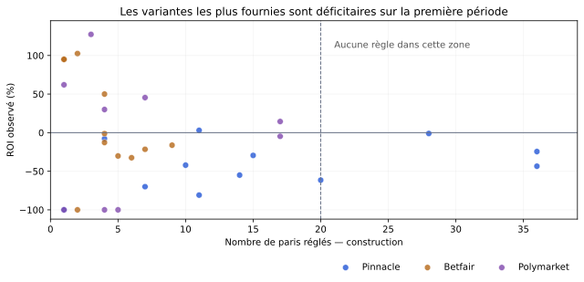

# Comparaison de 36 stratégies — 14 octobre 2026

**Aucune candidate ne passe le protocole. Il n’existe pas de rentabilité future
chiffrable de façon fiable avec cet historique.** Le laboratoire suit donc les
36 règles en simulation à partir du **14 octobre 2026 à 14 h, heure de Paris**.
Aucun pari réel n’est placé et aucune règle n’est automatiquement promue selon
son gain récent.

## Ce qui a été comparé

Trois références (Pinnacle sans marge, Betfair, Polymarket), trois plages de
cotes (1,30–2,00 ; 1,50–3,00 ; 2,00–5,00), deux seuils d’edge (2 % et 5 %, plafond
12 %) et deux délais maximum avant match (12 h et 36 h) : **36 combinaisons**.
La qualité des associations et la fraîcheur des cotes sont contrôlées à la prise.
Une seule sélection par match dans chaque règle, première détection admissible,
mise fixe fictive de 10 €. Aucun filtre ajouté selon les gagnants observés.

Les règles sont expliquées dans le [protocole](protocole-comparaison.md), figé
localement avant le calcul comparatif (commit `42160ef`). Il ne s’agit pas d’un
préenregistrement public : des agrégats de cet historique avaient déjà été vus.
Le [notebook exécuté](../notebooks/comparaison-strategies.ipynb), le
[relevé JSON complet](comparaison-strategies.json) et le
[calcul reproductible](../scripts/comparer_strategies.py) accompagnent le résultat.

## Source et audit

Relevé de la branche `donnees`, commit
[`56bed648894f383f04fb42f677ee9223d29c2abe`](https://github.com/Matttgic/cotes-value/tree/56bed648894f383f04fb42f677ee9223d29c2abe),
publié le 14/10/2026 à 10:09:28 UTC. SHA256 de `paris.json` :
`5d1a044eb1a5fbaf7261e2a149eaef2937731af42a7cbd22977bcceb8797ce31`.

- 9 307 lignes au total ; 7 881 sont le témoin Pinnacle brut, exclu de la famille.
- 1 426 lignes de vraies références, dont 1 173 pour les trois références étudiées.
- Parmi ces 1 173 : 404 passent la qualité commune avant les autres filtres,
  374 manquent de preuve conforme, 371 sont hors marché/période admis,
  18 ont une unité ambiguë et 6 échouent sur les dates ou la fraîcheur.
- Aucun ID dupliqué, aucun gain incohérent avec le statut, aucune date de règlement
  invalide et aucun conflit de règlement pour la même sélection entre références.

Ces contrôles ne prouvent pas que toutes les cotes étaient réellement disponibles
chez les bookmakers, ni que toutes les associations ou tous les scores sont justes.
L’historique contient les premières détections, pas toutes les occasions de reprendre
un pari plus tard à une autre cote. Des corrections de règlements tardives ne peuvent
pas être entièrement reconstruites depuis un seul relevé.

## Résultat du protocole

Périodes par début de match, heure de Paris : construction du 7 au 10 octobre,
validation les 11 et 12, test final le 13. Les règlements non encore connus à la
fin des deux premières périodes restent en attente dans leur évaluation.

Il fallait au moins 20 paris réglés, un ROI positif, une CLV positive et une
couverture de CLV d’au moins 50 % en construction. **Les quatre variantes qui
atteignent 20 réglés ont toutes un ROI négatif** :

| Référence | Cotes | Edge min. | Délai max. | Réglés | ROI construction |
|---|---|---|---|---:|---:|
| Pinnacle | 1,30–2,00 | 2 % | 36 h | 28 | −1,04 % |
| Pinnacle | 1,50–3,00 | 2 % | 36 h | 36 | −24,47 % |
| Pinnacle | 2,00–5,00 | 2 % | 12 h | 20 | −61,50 % |
| Pinnacle | 2,00–5,00 | 2 % | 36 h | 36 | −43,47 % |



Aucune finaliste n’atteint donc la phase de choix. Les autres périodes restent
publiées pour inspection ; leur résultat ne sert pas à contourner cette décision.
Cela ne prouve pas que toutes les règles sont perdantes à long terme. Cela signifie
que cette procédure et ces données ne permettent pas d’en retenir une.

### Pourquoi ne pas retenir simplement une variante positive ?

Exemple descriptif, **non retenu et choisi ici après lecture pour illustrer le
risque** : Polymarket, cotes 1,50–3,00, edge 2–12 %, délai maximal 36 h.

| Période | Réglés | En attente | Gain net | ROI | IC bootstrap 95 % | CLV |
|---|---:|---:|---:|---:|---|---:|
| Construction | 17 | 0 | +24,60 € | +14,47 % | −38,88 à +66,47 % | +6,01 % |
| Validation | 6 | 1 | +27,80 € | +46,33 % | −44,50 à +136,00 % | −1,58 % |
| Test final | 7 | 0 | +16,20 € | +23,14 % | −57,86 à +107,43 % | +0,19 % |

Le volume est insuffisant, la CLV de validation devient négative et le gain du
test final devient **−3,30 €** sans son meilleur pari. Ces bénéfices observés ne
justifient donc aucune prévision de +14 %, +23 % ou +46 %.

Les intervalles sont conditionnels à chaque règle : 5 000 tirages par match,
graine 20261014. Ils ne corrigent ni les 36 comparaisons ni les dépendances entre
rencontres d’une même journée. Avec un petit échantillon ou uniquement des pertes,
le bootstrap peut même produire un intervalle artificiellement étroit. Les profits
journaliers et les sensibilités sont publiés dans le JSON. Une CLV positive est un
indicateur de prix relatif, pas une garantie de bénéfice.

## Claude et ChatGPT V1 : comparateurs descriptifs

Rejeux hypothétiques en remontant le départ au 7 octobre. **Ce tableau n’est pas
le bilan officiel depuis leur lancement** ; les dates officielles restent intactes.
Claude peut prendre plusieurs paris corrélés par match et la V1 limite à cinq
sélections par jour : leurs expositions ne sont donc pas identiques.

| Rejeu | Construction : gain / ROI / réglés | Validation : gain / ROI / réglés | Test final : gain / ROI / réglés |
|---|---|---|---|
| Claude | +41,70 € / +5,64 % / 74 | +89,00 € / +15,34 % / 58 | +7,60 € / +5,07 % / 15 |
| ChatGPT V1 | −30,00 € / −100,00 % / 3 | +5,10 € / +7,29 % / 7 | −1,90 € / −9,50 % / 2 |

Claude a de meilleurs résultats observés sur ce rejeu, mais sa CLV sur le test
final est de −1,52 % ; il ne reste que −2,30 € de gain sur cette période sans son
meilleur pari. Son bootstrap par pari n’est pas publié : il ignorerait les paris
corrélés sur une même rencontre. La V1 ChatGPT n’a pas démontré de supériorité.
Ses seuils initiaux ne doivent pas être présentés comme optimisés ou validés.

## Suivi indépendant à venir

Le laboratoire dans Bilan conserve les règles et l’historique figés. Il calcule
séparément les sélections détectées à partir du 14/10 à 14 h (Paris) à chaque
construction du site : effectifs, attentes, gains, ROI et CLV. Les 30 dernières
sélections de chaque règle sont consultables ; les totaux portent sur toutes.
Les sélections enregistrées avant cette date n’entrent pas rétroactivement dans
le suivi. Les règles se chevauchent : **ne pas additionner leurs mises/gains**.

Ce suivi n’est pas une nouvelle recherche permanente de la meilleure ligne.
Avant une éventuelle promotion, il faudra fixer une nouvelle date de décision et
un protocole prospectif qui tienne compte des comparaisons multiples et du risque.
En l’état, la bonne décision est de collecter des preuves supplémentaires en
simulation ; aucune estimation de revenu mensuel ou de ROI futur n’est étayée.

## Reproduire

À partir du dépôt de code, avec Python et les dépendances habituelles du projet :

```sh
git worktree add --detach ../cotes-value-releve 56bed648894f383f04fb42f677ee9223d29c2abe
python scripts/comparer_strategies.py --donnees ../cotes-value-releve --sortie /tmp/comparaison.json
python -m pytest -q
```

Le commit de données doit être disponible localement (récupérer la branche
`donnees` si nécessaire). Le champ `calcule_le` change à chaque exécution ; les
métriques restent déterministes. Le notebook lit le relevé JSON versionné,
vérifie la décision et produit les tableaux et le graphique sans accès réseau.
